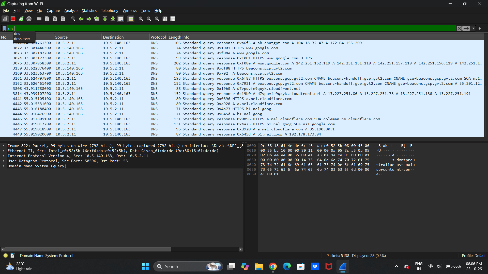
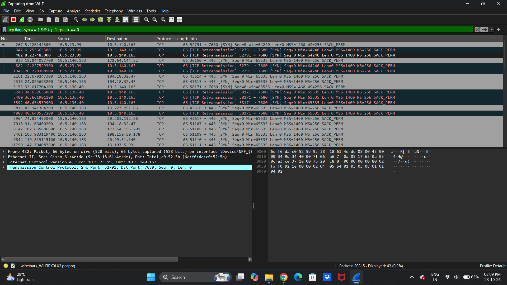
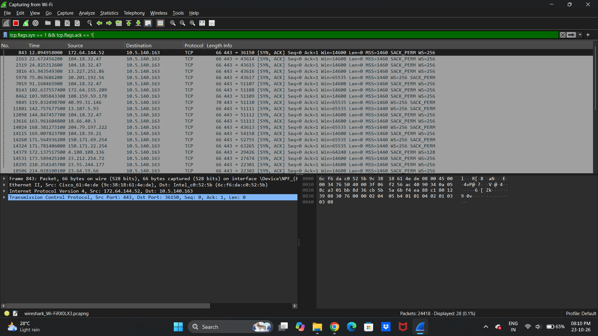
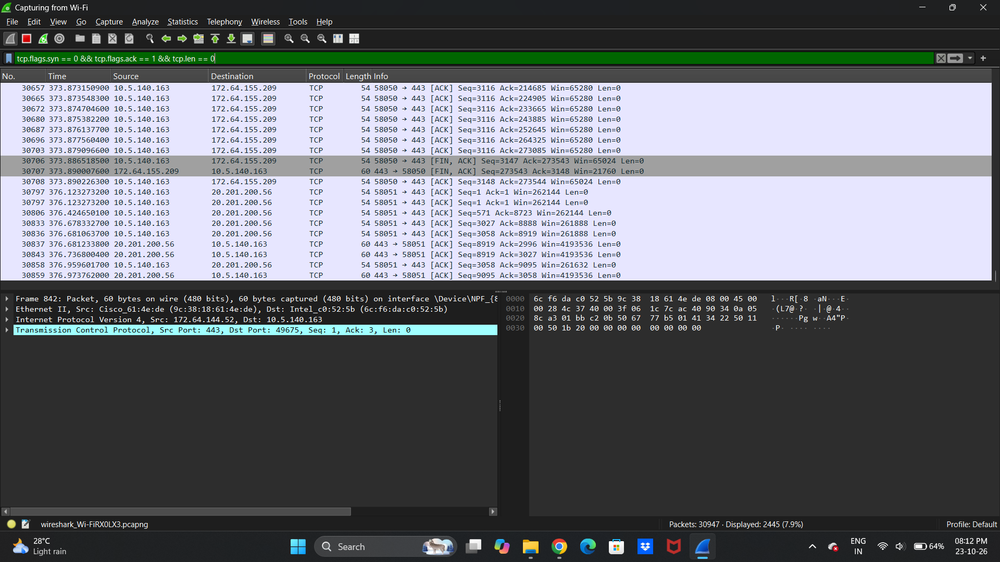
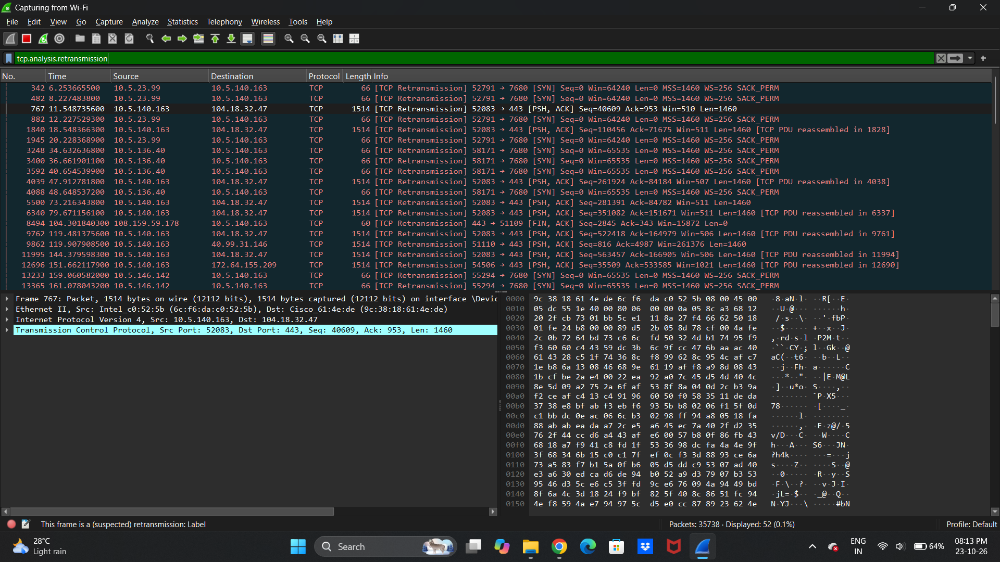

# InternSpark Cybersecurity Internship – Task 3
## Wireshark Packet Analysis & Network Traffic Investigation


---

## 📌 Project Overview

This repository documents the practical work completed for **Task 3: Wireshark Packet Analysis** as part of the **InternSpark Cybersecurity Internship**.

The project focuses on capturing and examining live network traffic using Wireshark to understand how common network protocols operate. The analysis covers Domain Name System (DNS) traffic, TCP connection establishment, TCP control flags, and packets identified by Wireshark as retransmissions.

Through practical packet inspection and display filtering, this project demonstrates fundamental network analysis techniques used in network troubleshooting, traffic investigation, and cybersecurity monitoring.

The analysis was conducted on the author's own Windows laptop using its Wi-Fi network interface for educational purposes.

## 🎯 Project Objectives

The primary objectives of this task were to:

- Capture live network traffic using Wireshark.
- Understand the structure and purpose of network packets.
- Identify DNS queries and responses generated during domain resolution.
- Analyze TCP SYN and SYN-ACK packets involved in connection establishment.
- Examine TCP ACK packets and understand acknowledgement behavior.
- Identify packets labelled as TCP retransmissions.
- Practice Wireshark display filters for protocol-specific investigation.
- Document practical observations with screenshots and a packet capture file.
- Understand the difference between normal network behavior, troubleshooting indicators, and confirmed security findings.

## 🛠️ Tools & Technologies

| Tool / Technology | Purpose |
|---|---|
| Wireshark 4.6.9 | Capturing, filtering, and inspecting network packets |
| Npcap 1.88 | Packet capture support on Windows |
| Windows | Operating system used for the practical exercise |
| Wi-Fi Network Interface | Interface selected for live packet capture |
| PCAPNG | File format used to save the captured network traffic |

## 🔬 Scope of the Assessment

The practical exercise focused on observing selected network protocols and TCP behavior within a limited capture session.

**Included in scope:**
- Live network traffic capture.
- DNS query and response inspection.
- TCP SYN packet identification.
- TCP SYN-ACK packet identification.
- TCP ACK packet filtering.
- TCP retransmission indicator analysis.
- Screenshot documentation and preservation of packet capture evidence.

**Outside the scope:**
- Penetration testing of external systems.
- Exploitation of network services.
- Decryption of HTTPS traffic.
- Confirmation of malicious activity or a security breach.
- Comprehensive network-wide vulnerability assessment.

## 🧪 Methodology

### 1. Network Traffic Capture

Wireshark was launched on Windows, and the Wi-Fi network interface was selected to capture live packets.

The capture was allowed to collect ordinary network traffic generated during the session. The captured traffic was then examined using display filters to isolate relevant protocols and TCP packet types.

### 2. DNS Traffic Analysis

**Display filter:**

```text
dns
```

The DNS display filter was used to isolate DNS packets from the captured traffic.

DNS is responsible for resolving domain names into IP addresses and providing other domain-related records. Inspecting DNS traffic helps demonstrate how devices perform domain lookups when communicating with online services.

The captured evidence showed DNS queries and responses associated with domain lookups, including visible entries for `www.google.com` and `chatgpt.com`.

**Evidence:** [View DNS Query and Response Screenshot](screenshots/01_dns_query_response.png)

### 3. TCP SYN Packet Analysis

**Display filter:**

```text
tcp.flags.syn == 1 && tcp.flags.ack == 0
```

This filter identifies TCP packets with the SYN flag enabled and the ACK flag disabled.

A SYN packet is typically used to initiate a TCP connection. Examining these packets helps identify connection attempts and understand how TCP communication begins.

**Evidence:** [View TCP SYN Screenshot](screenshots/02_tcp_syn.png)

### 4. TCP SYN-ACK Packet Analysis

**Display filter:**

```text
tcp.flags.syn == 1 && tcp.flags.ack == 1
```

This filter identifies TCP packets containing both SYN and ACK flags.

During a normal TCP three-way handshake, the server or receiving endpoint typically responds to an initial SYN with a SYN-ACK packet. This acknowledges the connection request and participates in establishing the connection.

The captured screenshot provides evidence of packets matching this filter. However, the filter does not independently prove that every connection completed a successful handshake.

**Evidence:** [View TCP SYN-ACK Screenshot](screenshots/03_tcp_syn_ack.png)

### 5. TCP ACK Packet Analysis

**Display filter:**

```text
tcp.flags.syn == 0 && tcp.flags.ack == 1 && tcp.len == 0
```

This filter displays TCP packets with the SYN flag disabled, the ACK flag enabled, and zero TCP payload length.

TCP acknowledgements communicate receipt of data or connection-related information. Such packets are commonly seen during TCP communication.

This filter can display ordinary ACK packets as well as packets that may participate in connection establishment. Therefore, the filtered output should not be interpreted as containing only the third packet of the TCP three-way handshake.

**Evidence:** [View TCP ACK Screenshot](screenshots/04_tcp_ack.png)

### 6. TCP Retransmission Analysis

**Display filter:**

```text
tcp.analysis.retransmission
```

This filter identifies packets that Wireshark marks as TCP retransmissions according to its packet-analysis heuristics.

TCP retransmissions may occur when acknowledgements are delayed or missing, packets are lost, or network conditions affect communication. They can be useful indicators when investigating connectivity or performance issues.

The capture contained multiple packets labelled as retransmissions. These observations warrant context-aware interpretation but do not independently confirm packet loss, a network fault, a security vulnerability, or a malicious attack.

**Evidence:** [View TCP Retransmission Screenshot](screenshots/05_tcp_retransmission.png)

## 📊 Findings & Observations

| No. | Observation | Evidence | Interpretation |
|---|---|---|---|
| 1 | DNS queries and responses were visible | DNS filter screenshot | Demonstrates DNS traffic during domain lookups |
| 2 | TCP SYN packets were observed | SYN filter screenshot | Indicates packets matching the initial TCP SYN filter |
| 3 | TCP SYN-ACK packets were observed | SYN-ACK filter screenshot | Indicates packets matching the SYN-ACK filter |
| 4 | TCP ACK packets were displayed | ACK filter screenshot | Demonstrates TCP acknowledgement traffic with zero payload |
| 5 | Multiple retransmission-labelled packets were displayed | Retransmission filter screenshot | Provides an observation for further network-level investigation if persistent |

### Interpretation of Findings

The practical exercise successfully demonstrated how Wireshark display filters can be used to isolate DNS and TCP traffic from a live packet capture.

The observed retransmission indicators may be useful during network troubleshooting. However, determining their cause would require additional investigation, such as examining packet timestamps, TCP sequence and acknowledgement numbers, repeated captures, and the relevant network conditions.

**No confirmed security vulnerability or malicious activity was established by this exercise.**

## 📸 Screenshots & Evidence

The following screenshots document the practical analysis performed in Wireshark.

### 1. DNS Query and Response Analysis



*Figure 1: DNS packets isolated using the `dns` display filter.*

[Open Screenshot](screenshots/01_dns_query_response.png)

### 2. TCP SYN Packet Analysis



*Figure 2: Initial TCP SYN packets identified using TCP flag filtering.*

[Open Screenshot](screenshots/02_tcp_syn.png)

### 3. TCP SYN-ACK Packet Analysis



*Figure 3: TCP packets matching the SYN-ACK display filter.*

[Open Screenshot](screenshots/03_tcp_syn_ack.png)

### 4. TCP ACK Packet Analysis



*Figure 4: TCP acknowledgement packets with zero payload length.*

[Open Screenshot](screenshots/04_tcp_ack.png)

### 5. TCP Retransmission Analysis



*Figure 5: Packets identified by Wireshark as TCP retransmissions.*

[Open Screenshot](screenshots/05_tcp_retransmission.png)

## 📁 Repository Structure

```text
INTERNSPARK_CS_03/
│
├── README.md
│
├── screenshots/
│   ├── 01_dns_query_response.png
│   ├── 02_tcp_syn.png
│   ├── 03_tcp_syn_ack.png
│   ├── 04_tcp_ack.png
│   └── 05_tcp_retransmission.png
│
├── capture/
│   └── internspark_task3_capture.pcapng
│
└── report/
    └── InternSpark_Task3_Wireshark_Packet_Analysis_Report.pdf
```

*The structure above documents the intended organization. Ensure the actual filenames and folder contents match before submission.*

## 🛡️ Recommendations & Best Practices

Based on the scope of this exercise, the following practices are recommended:

1. **Investigate persistent retransmissions:** If retransmissions occur repeatedly, perform additional captures and examine connection-level details before identifying a cause.
2. **Inspect TCP sequence information:** Review sequence numbers, acknowledgement numbers, timestamps, and relevant packet context when troubleshooting.
3. **Compare multiple capture sessions:** Repeated observations can help distinguish isolated events from persistent network behavior.
4. **Protect capture files:** PCAPNG files may contain IP addresses, hostnames, device metadata, and other potentially sensitive information. Review them before sharing.
5. **Use authorized environments:** Capture traffic only on devices and networks for which appropriate permission is available.
6. **Avoid unsupported conclusions:** Do not classify retransmissions as an attack or vulnerability without corroborating evidence.

These are general recommendations for network analysis and are not claims that a specific vulnerability was discovered.

## ⚠️ Limitations

- The analysis was limited to the traffic visible during a single capture session.
- Network conditions and packet counts can change over time.
- Display filters identify packets matching specified conditions but do not, by themselves, establish the cause of a network event.
- Retransmission labels require additional context before drawing conclusions about network performance.
- Encrypted HTTPS application payloads were not decrypted as part of this exercise.
- No comprehensive penetration test or vulnerability assessment was performed.

## 📚 Learning Outcomes

Through this task, the following practical skills were developed:

- Capturing live network traffic using Wireshark.
- Filtering DNS queries and responses.
- Understanding TCP SYN, SYN-ACK, and ACK flags.
- Applying TCP display filters for packet inspection.
- Recognizing Wireshark retransmission indicators.
- Documenting network observations using screenshots.
- Preserving packet capture evidence for further analysis.
- Distinguishing observed network behavior from confirmed security findings.

## 📄 Project Report

The detailed report for this task is available in the repository:

**[📄 View Wireshark Packet Analysis Report (PDF)](report/InternSpark_Task3_Wireshark_Packet_Analysis_Report.pdf)**

The report provides the methodology, packet-analysis observations, supporting evidence, limitations, and recommendations in a formal technical-report format.

## ⚖️ Disclaimer

This project was conducted for educational purposes as part of the InternSpark Cybersecurity Internship. Packet capture was performed on the author's own device and network interface.

The findings describe observations from the available capture evidence only. They should not be treated as proof of a security vulnerability, malicious activity, or a network incident without further validation.

---

**InternSpark Cybersecurity Internship | Task 3 – Wireshark Packet Analysis**

